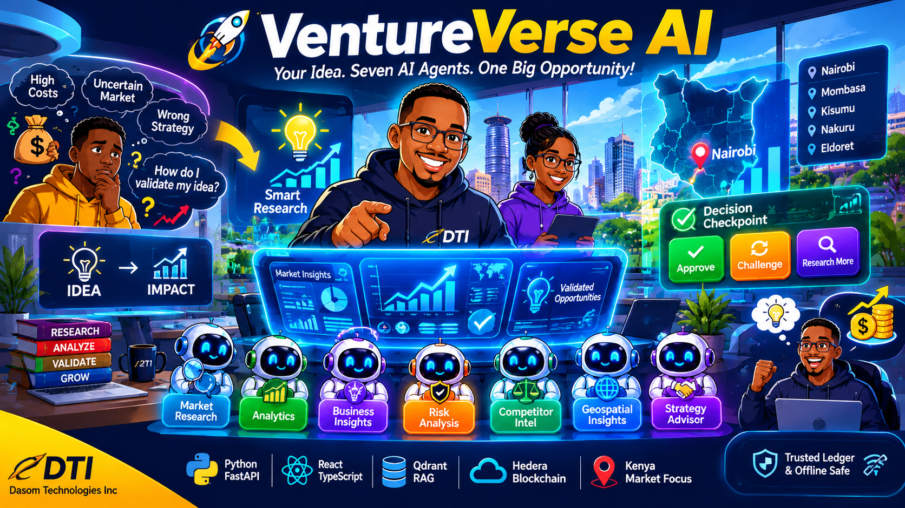

# VentureVerse AI



VentureVerse is a founder-facing market validation game: a founder enters a business idea, the app runs research agents, scores the opportunity, and surfaces a checkpoint where the founder decides whether to proceed, challenge, or ask for more evidence.

The project is currently a full-stack monorepo with:
- a Python/FastAPI backend for missions, scoring, routing, and the game loop
- a React + Vite frontend for the interactive dashboard and command-center UI
- a local map view that emphasizes Nairobi while keeping the rest of the relevant Kenyan cities visible in the same scene
- a hash-chained ledger and simulated trust layer for the challenge flow

## Current stack

- Backend: Python 3.11, FastAPI, Qdrant-backed retrieval, MCP client/server integration
- Frontend: React 18, TypeScript, Vite, React Three Fiber, Leaflet + React Leaflet
- Storage: in-memory mission state plus Qdrant for evidence passages
- AI: local Ollama when available; otherwise a deterministic offline-template fallback
- Demo mode: sample market data, simulated Hedera-style ledger anchoring, and offline-safe behavior

## Project layout

```text
venture-verse/
├── backend/
│   ├── app/
│   │   ├── agents/
│   │   │   ├── orchestrator.py
│   │   │   └── summaries.py
│   │   ├── data/
│   │   │   ├── agents.json
│   │   │   ├── claims.json
│   │   │   └── venture.json
│   │   ├── rag/
│   │   │   ├── embedder.py
│   │   │   └── store.py
│   │   ├── tools/
│   │   │   ├── gateway.py
│   │   │   └── registry.py
│   │   ├── __init__.py
│   │   ├── config.py
│   │   ├── data_loader.py
│   │   ├── ledger.py
│   │   ├── llm.py
│   │   ├── main.py
│   │   ├── schemas.py
│   │   ├── scoring.py
│   │   └── state.py
│   ├── mcp_server/
│   │   └── server.py
│   ├── tests/
│   │   ├── conftest.py
│   │   ├── test_api.py
│   │   ├── test_ledger.py
│   │   ├── test_llm.py
│   │   ├── test_mcp.py
│   │   └── test_scoring.py
│   ├── .venv/
│   ├── pytest.ini
│   ├── requirements.txt
│   └── requirements-dev.txt
├── frontend/
│   ├── src/
│   │   ├── App.tsx
│   │   ├── components/
│   │   │   ├── CheckpointModal.tsx
│   │   │   ├── Chips.tsx
│   │   │   ├── EvidencePanel.tsx
│   │   │   ├── LedgerPanel.tsx
│   │   │   ├── LocationMap.tsx
│   │   │   ├── MissionPanel.tsx
│   │   │   ├── RagPanel.tsx
│   │   │   ├── Scene.tsx
│   │   │   └── Simulator.tsx
│   │   ├── lib/
│   │   │   ├── api.ts
│   │   │   ├── types.ts
│   │   │   └── useMission.ts
│   │   ├── main.tsx
│   │   ├── styles.css
│   │   └── vite-env.d.ts
│   ├── index.html
│   ├── package.json
│   ├── tsconfig.json
│   └── vite.config.ts
├── e2e/
│   ├── smoke.mjs
│   └── package.json
├── Dockerfile
├── docker-compose.yml
├── Makefile
├── README.md
└── .gitignore
```

## Quick start

Requirements: Python 3.11+ and Node 20+.

### Option 1: install and run the project from the repo root

```bash
cd /path/to/venture-verse
make install
make serve
```

This installs backend Python dependencies, installs frontend npm dependencies, builds the React app, and serves the app on:
- http://127.0.0.1:8000

### Option 2: run backend and frontend separately

```bash
cd backend
python3.11 -m venv .venv
. .venv/bin/activate
pip install -r requirements-dev.txt
uvicorn app.main:app --reload --port 8000
```

In a second terminal:

```bash
cd frontend
npm install
npm run dev
```

The Vite dev server runs at http://localhost:5173 and the backend remains on http://localhost:8000.

## Useful Make targets

```bash
make install
make dev-api
make dev-web
make build
make serve
make test
make e2e
```

Current meanings:
- `make install`: installs Python + Node dependencies
- `make dev-api`: runs the backend in reload mode on port 8000
- `make dev-web`: runs the frontend Vite dev server on port 5173
- `make build`: builds the production frontend bundle
- `make serve`: builds the frontend and serves the app via FastAPI on port 8000
- `make test`: runs backend pytest
- `make e2e`: installs Playwright dependencies and runs the smoke test against the app

## Current app behavior

The app is a mission-driven research simulator based on a founder brief.

A founder can:
- enter a business idea
- trigger a mission
- run seven agents in sequence
- inspect evidence and claims
- apply labels to claims
- review a recommendation checkpoint
- verify the ledger history

The dashboard currently includes:
- a command-center / 3D stage
- a mission panel with a founder brief and agent queue
- evidence and ledger tabs
- a location map that centers Nairobi while showing the broader Kenyan market footprint, including the other relevant cities and towns in the same visual

## Map and region view

The current map behavior intentionally emphasizes Nairobi as the anchor city, while showing the surrounding market cities in the same map frame. This makes the launch city feel central without losing the wider regional context.

The city ring overlays and labels are driven by the mission data and the current venture dataset in:
- `backend/app/data/venture.json`
- `frontend/src/components/LocationMap.tsx`

## Backend API summary

The current app exposes these routes through FastAPI:

- `GET /api/health` — returns backend health, active LLM, embedder mode, vector store state, and passage count
- `GET /api/world` — returns the world model: agents, cities, competitors, segments, and leads
- `POST /api/missions` — creates a mission from a founder idea
- `POST /api/missions/{id}/agents/{agent}/run` — runs an agent for a mission
- `GET /api/missions/{id}/checkpoint` — opens a checkpoint view
- `POST /api/missions/{id}/checkpoint` — approves, challenges, or requests more research
- `GET /api/missions/{id}/ledger` — reads the mission ledger
- `POST /api/missions/{id}/ledger/verify` — verifies the hash chain
- `POST /api/rag/search` — searches the evidence store
- `POST /api/rag/ingest` — ingests founder notes into the mission store
- `POST /api/scenario` — runs the scenario simulation tool

The interactive OpenAPI docs are available at:
- http://localhost:8000/docs

## Testing

```bash
cd backend
python -m pytest -q
```

This project currently includes backend tests covering the API, ledger, scoring logic, LLM client behavior, and MCP interactions.

## Optional local model setup

If Ollama is installed locally, the app will use it automatically when available.

```bash
ollama serve
ollama pull gpt-oss:20b
```

When Ollama is reachable, `/api/health` reflects the active model. When it is not, the app falls back to a deterministic offline template so the demo still runs.

## Notes

- The current venture data is sample/demo data for the app’s gameplay and research flow.
- The ledger is a simulated hash-chained flow intended for challenge/demo use rather than production blockchain anchoring.
- The app is designed for human decision-making: the founder stays in control of approvals and checkpoint decisions.

# ventureverse-ai
